# Hard-Sphere Bridge

[](https://github.com/MozillaFiredoge/hard-sphere-bridge/actions/workflows/ci.yml)
[](LICENSE)

CUDA-accelerated Newtonian hard-sphere simulation, with synchronized
microscopic particle dynamics, mesoscopic phase-space statistics, and
macroscopic fluid fields.

The project asks a concrete computational question: if only Newtonian free
flight and elastic hard-sphere collisions are simulated, when do reproducible
kinetic and fluid-scale structures emerge? It follows the same particle state
through three descriptions—no SPH/PBF force law and no fluid solver feeds back
into the particles:

$$
\{x_i(t),v_i(t)\}_{i=1}^{N}
\longrightarrow \widehat f_N(x,v_x,t)
\longrightarrow n(x,t),u_x(x,t),T(x,t),p(x,t).
$$

Start with the [headline results](#headline-results), run the
[CPU smoke test](#quick-start), read the complete
[experiment design](docs/experiment-design.md), or inspect the
[archived result tables and figures](docs/results/). Mathematical context and
citations are collected in [the references](docs/references.md).

## From particles to fields

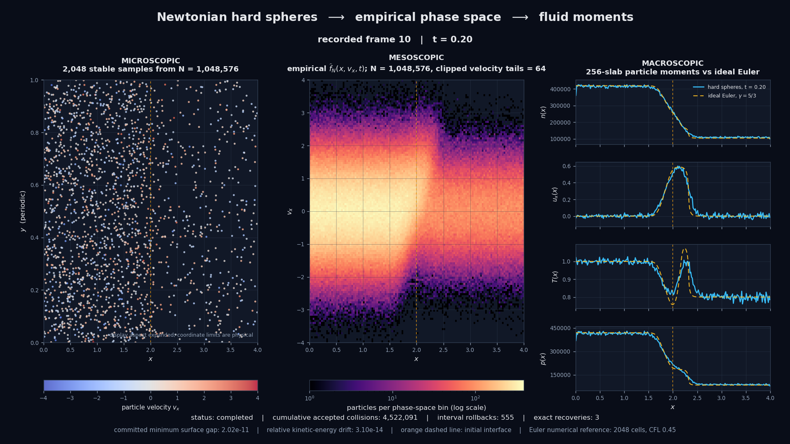

This frame comes from one \(N=1{,}048{,}576\) hard-sphere state at \(t=0.20\).
The left panel shows a stable 2,048-particle sample, the center panel bins the
complete particle array into empirical \(x-v_x\) phase space, and the right
panel takes particle moments and overlays an independently evolved ideal Euler
reference. No fluid solver advances or corrects the particles.

The completed run reached \(t=0.20\) with 4,522,091 accepted collisions,
positive committed surface gaps, and maximum relative kinetic-energy drift
\(4.72\times10^{-14}\). Its first wave-kinematics comparison also passes the
configured position, speed, and coarse-graining checks; see
[the recorded results](docs/results/wave-kinematics/summary.json).

## Headline results

Factorial-scan values below use the largest sampled population,
\(N=524{,}288\), unless the row explicitly summarizes all scan cells.

| Question | Evidence | Result |
|---|---|---|
| Can the hard-sphere state be followed from particles to fields? | One synchronized \(N=1{,}048{,}576\) shock tube | Complete micro/meso/macro outputs from the same state; no fluid feedback |
| Does increasing \(N\) remove finite-sample noise? | 36 CUDA trajectories over three \(N\), three Kn, and four seeds | Confidence-band widths scale with mean log--log slope -0.508, close to \(N^{-1/2}\) |
| Do macroscopic waves propagate at fluid-like speeds? | Rarefaction/contact/compression markers | At the largest low-Kn cell: -0.790, +0.742, +1.687 versus Euler -0.797, +0.698, +1.689 |
| What explains the low-Kn velocity-profile mismatch? | Same-grid Enskog transport ablation | Shear viscosity is dominant; at Kn=0.02 it improves 8/10 saved frames and lowers the final error by 49.3% |
| Where does the first-order fluid closure fail? | Full saved-frame comparison | At Kn=0.10, shear raises the mean velocity error by 44.8%; full NSF raises it by 56.5% |

The central result is deliberately bounded. The hard-sphere ensemble develops
stable coarse-grained shock-tube structure, finite-sample uncertainty behaves
approximately as expected, and first-order Enskog transport explains much of
the late-time low-Kn broadening. The same closure is worse during the initial
kinetic transient and over nearly the entire Kn=0.10 evolution. The negative
result is part of the project: it identifies where a local first-gradient
continuum reference stops being credible.

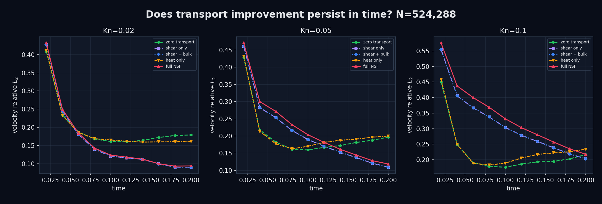

## Scientific status

This is an experimental numerical project, not a proof of Hilbert's sixth
problem, not a direct deterministic solver for the Boltzmann equation, and not
a claim that one finite simulation establishes a hydrodynamic limit.

- The small CPU implementation is a globally event-driven correctness
  reference.
- The large CUDA implementation uses continuous collision prediction inside
  adaptive parallel windows, with rollback and deterministic exact
  short-window recovery.
- Endpoint overlap detection cannot prove that two particles did not cross and
  separate again within one rejected or accepted window; time-window
  refinement remains required.
- The Euler solver is an independent ideal-gas comparison and never changes a
  particle trajectory.
- The million-particle shock tube is one configured realization. Independent
  eight-seed fields and a 36-trajectory particle-count × Knudsen matrix test
  sampling sensitivity, but four seeds per factorial cell remain a small
  ensemble.
- Saved frames from one trajectory are correlated observations, not
  independent replicates. They test temporal persistence without increasing
  the effective seed count.
- Lowering Kn in the factorial scan changes sphere diameter and packing
  fraction at fixed local number density. Finite-Kn transport and excluded
  volume are diagnosed separately where possible, not claimed to be fully
  disentangled.

See [the experiment design](docs/experiment-design.md) for definitions and
acceptance criteria, and [the contribution guide](CONTRIBUTING.md) for the
evidence required when changing collision or interpretation logic.

## Quick start

### Requirements

- CMake 3.24 or newer;
- a C++20 compiler;
- Boost 1.75 or newer with Boost.JSON headers;
- optionally CUDA 12 or newer;
- for offline figures, Python 3 with NumPy and Matplotlib;
- optionally FFmpeg for MP4 encoding.

### Build

The quickest CPU-only build uses the checked-in presets:

```bash
cmake --preset cpu-release
cmake --build --preset cpu-release
ctest --preset cpu-release
./build/cpu-release/particles_cli --help
./build/cpu-release/particles_cli smoke
```

The equivalent explicit configuration is:

```bash
cmake -S . -B build -DCMAKE_BUILD_TYPE=RelWithDebInfo
cmake --build build -j
ctest --test-dir build --output-on-failure
```

The examples below use this explicit `build/` layout. If you selected a
preset, substitute `build/cpu-release/` or `build/cuda-release/` as
appropriate.

The CLI never launches an experiment implicitly. Run
`./build/particles_cli --help` for all commands and defaults. Unknown commands
return exit status 2.

Run the small event-driven equilibrium reference experiment from the repository
root:

```bash
./build/particles_cli equilibrium \
  configs/equilibrium.json \
  output/equilibrium
```

This writes `summary.csv` and `velocity_histogram.csv` in the selected output
directory.

On a machine with a visible CUDA device, compare the GPU SoA/cell-list result
against the CPU reference:

```bash
./build/particles_cli cuda-grid configs/equilibrium.json
```

Run the first controlled window-parallel convergence experiment:

```bash
./build/particles_cli window-convergence \
  configs/equilibrium.json \
  output/window-convergence.csv
```

The command reuses one initialized state, runs the small \(O(N^2)\)
event-driven oracle once, and then evaluates the mutual-earliest window
approximation at the configured \(\Delta t,\Delta t/2,\Delta t/4,\ldots\).
The CSV records periodic position/velocity errors, collision-count error,
contended events, candidate-horizon clipping, conservation drift, penetration,
and wall-clock time. A CUDA build with a visible device writes paired `cpu`
and `cuda` rows and includes their RMS state difference.

Run the deterministic causal-chain convergence experiment:

```bash
./build/particles_cli window-scenario \
  configs/causal_chain.json \
  output/causal-chain-convergence.csv
```

This three-sphere case is deliberately nontrivial. With the configured
\(\Delta t=0.5\), the first collision creates a second collision that was not
present in the start-of-window event list, so the run must stop with
`overlap_detected`. At \(\Delta t=0.25\) and \(0.125\), the intervening rebuild
finds the causal collision and both runs should complete with two collisions
and no overlap. A coarse-level stop is therefore the expected convergence
signal, not a test failure.

Run the multi-seed random collision stress experiment:

```bash
./build/particles_cli window-stress \
  configs/window_stress.json \
  output/window-stress
```

The default scan uses 256 particles, four fixed seeds, and eight refinements
from \(\Delta t=0.06\) to \(0.00046875\). It writes `runs.csv` with every
seed/backend/level and `summary.csv` with completion rate, overlap-stop rate,
collision-count error, contended-event rate, state error, conservation drift,
and timing. Failed runs are compared with the exact reference at their actual
stop time.

Run the transactional adaptive-window experiment on the same seeds:

```bash
./build/particles_cli window-adaptive-stress \
  configs/window_stress.json \
  output/window-adaptive-stress
```

Each step begins with a particle-state checkpoint. If endpoint diagnostics
find penetration, the attempted state is discarded and the local window is
halved. A reduced successful window is retained and doubled only after four
consecutive successful steps. `runs.csv` records attempts, rollbacks, growths,
maximum refinement depth, minimum accepted window, rejected work,
exact-reference error, and CPU/GPU state difference. The default CPU baseline
completes all four seeds with exact collision counts and reduces the rollback
rate from 70.2% for reset-to-maximum control to 17.9%.

Run the CUDA weak-scaling benchmark:

```bash
./build/particles_cli cuda-scaling \
  configs/cuda_scaling.json \
  output/cuda-scaling.csv
```

The default levels double from \(2^{10}\) to \(2^{20}\) particles while
holding number density, diameter, temperature, and packing fraction fixed.
The periodic cubic domain grows as \(N^{1/3}\). Each row records initialization,
allocation and transfer time; grid and candidate density; adaptive attempts,
rollbacks and collisions; committed and attempted particle-window throughput;
observed device memory; conservation drift; and endpoint penetration status.
This is a scaling and capacity experiment, not an exact-reference comparison.
If a device runs out of memory, completed lower levels remain in the flushed
CSV and the failing level is printed.

Generate the first micro-to-meso-to-macro snapshot from the million-particle
shock-tube initial condition:

```bash
./build/particles_cli multiscale-snapshot \
  configs/shock_tube.json \
  output/multiscale-snapshot
```

All three layers are derived from the same particle array. The command writes
stable representative particle samples to `microscopic.csv`, the
\(x-v_x\) histogram to `phase_space.csv`, slab-wise
\(\rho,u,T,p\) to `macroscopic.csv`, and cross-layer conservation checks to
`summary.csv`. The default million-particle snapshot takes about 0.22 seconds
to measure on the current CPU baseline, excluding initialization and CSV I/O.

Run the complete evolving shock-tube pipeline first with the 4096-particle
smoke configuration:

```bash
./build/particles_cli shock-tube \
  configs/shock_tube_smoke.json \
  output/shock-tube-smoke
```

Then run the configured million-particle experiment:

```bash
./build/particles_cli shock-tube \
  configs/shock_tube.json \
  output/shock-tube
```

An optional fourth argument overrides only the end time for a short recovery
or performance check. For example, this crosses the first observed dense
contact chain without waiting for the full first output interval:

```bash
./build/particles_cli shock-tube \
  configs/shock_tube.json \
  output/shock-tube-recovery-check \
  0.0012
```

The command uses CUDA when a device is visible and otherwise falls back to the
CPU implementation. It advances adaptive transactional windows between output
times, with reflecting walls on \(x\) and periodic boundaries on \(y,z\).
If a near-zero-time collision chain still overlaps at the configured minimum
window, the controller restores its checkpoint, advances that short interval
with deterministic exact-event batches, and then resumes parallel windows.
Every output time appends synchronized rows to `microscopic.csv`,
`phase_space.csv`, `macroscopic.csv`, and `summary.csv`. `evolution.csv`
records attempts, rollbacks, exact recoveries, rejected and committed minimum
gaps, collisions, energy drift, transverse momentum drift, and per-frame
simulation time. The runner also copies the exact input to `input-config.json`
and writes `run-metadata.json` with the project version, Git commit and dirty
state at configure time, compiler/build information, backend, seed, effective
end time, and visible CUDA device information.

Render those five CSV files as synchronized micro-to-macro figures and an MP4:

```bash
python3 -m venv .venv
. .venv/bin/activate
python -m pip install -r requirements-visualization.txt
python3 tools/visualize_shock_tube.py \
  output/shock-tube \
  --config configs/shock_tube.json
```

The renderer creates `visualization/macroscopic-evolution.png`, a 1920x1080
PNG for every recorded time in `visualization/frames/`,
`visualization/final-overview.png`, `visualization/shock-tube.mp4`, and a
machine-readable `visualization/manifest.json`. It also solves a separate
one-dimensional monatomic ideal-gas Euler reference and writes
`euler-reference.csv` plus the frame/field errors in `euler-comparison.csv`.
Each video frame places a stable 2048-particle microscopic sample, the
\(x-v_x\) histogram accumulated from the full particle array (with clipped
velocity tails reported), and the all-particle 256-slab \(n,u_x,T,p\) moments
with the Euler curves overlaid. Axis and color ranges are fixed over the
complete run.

The Euler baseline uses \(\gamma=5/3\), the configured smooth initial profile,
reflecting longitudinal boundaries, 2048 finite-volume cells, MUSCL/minmod
reconstruction, Rusanov fluxes, SSP-RK2 time integration, and CFL 0.45. It is
a diagnostic numerical reference and never participates in particle
advancement. Use `--euler-cells` or `--euler-cfl` to refine it, or
`--no-euler` to reproduce a particle-only view. The default video uses two
recorded simulation frames per second and does not interpolate unrecorded
particle states. Use `--fps`, `--dpi`, `--output`, or `--no-video` to change
packaging without changing the underlying diagnostics.

The manifest records source CSV hashes, the configuration hash, Git commit and
dirty state, renderer hash, Python package versions, FFmpeg version, and basic
platform information. Paths inside the repository are stored relative to the
repository root.

Validate the Euler solver's steady-state preservation, positivity,
conservation, and 1024/2048/4096-cell refinement:

```bash
python3 tools/euler_reference.py \
  --self-test \
  --grid-check \
  configs/shock_tube.json
```

## Wave-kinematics experiment

After rendering the complete run, extract the rarefaction-gradient, contact,
and compression markers independently from the particle and Euler fields:

```bash
python3 tools/analyze_wave_kinematics.py \
  output/shock-tube/macroscopic.csv \
  output/shock-tube/visualization/euler-reference.csv \
  --simulation-config configs/shock_tube.json \
  --analysis-config configs/wave_kinematics.json \
  --output output/shock-tube/wave-kinematics
```

Both profiles use the same physical smoothing length. The marker definitions,
late-time fit interval, sensitivity values, and acceptance limits are frozen
in [`configs/wave_kinematics.json`](configs/wave_kinematics.json). Propagation
speeds are fitted as \(x(t)=x_0+ct\) over five synchronized frames from
\(t=0.12\) through \(0.20\).

| marker | hard spheres \(c\) | ideal Euler \(c\) | relative speed difference | mean position difference |
|---|---:|---:|---:|---:|
| rarefaction gradient | -0.833 | -0.797 | 4.5% | 0.0062 |
| contact | +0.784 | +0.698 | 12.3% | 0.0143 |
| compression | +1.661 | +1.689 | 1.7% | 0.0151 |

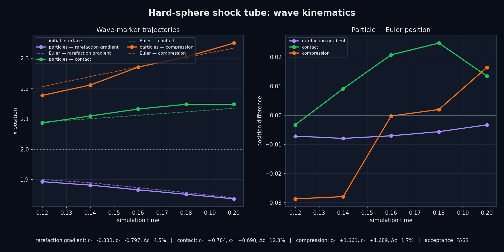

These markers are reproducible coarse-grained diagnostics, not claims of exact
discontinuity location. The contact marker is the most noise-sensitive: the
0.06, 0.07, and 0.08 smoothing lengths pass all configured checks, while 0.04
and 0.05 exceed the 20% contact-speed limit. The full
[sensitivity plot](docs/results/wave-kinematics/smoothing-sensitivity.png),
[position rows](docs/results/wave-kinematics/wave-positions.csv), and
[speed summary](docs/results/wave-kinematics/wave-speeds.csv) are checked in.
This first result is exploratory; its definitions and thresholds are now
frozen for the future multi-seed and scale scans.

## Multi-seed uncertainty experiment

Run or resume the eight independent CUDA realizations, then build field and
wave-marker uncertainty reports:

```bash
python3 tools/run_multiseed_shock_tube.py \
  configs/shock_tube_multiseed.json \
  --executable build/cuda-release/particles_cli \
  --output output/shock-tube-multiseed

python3 tools/analyze_multiseed_fields.py \
  configs/shock_tube_multiseed.json \
  output/shock-tube-multiseed \
  --wave-config configs/wave_kinematics.json
```

The formal batch completed all eight seeds through \(t=0.20\), with
\(N=65{,}536\) particles and 128 macroscopic slabs per seed. Every committed
state passed the configured energy and surface-gap checks. At the final frame:

| field | relative \(L_2\), seed mean vs Euler | relative RMS 95% CI half-width | Euler-in-band slab fraction |
|---|---:|---:|---:|
| number density | 3.09% | 2.88% | 68.8% |
| bulk velocity \(u_x\) | 22.24% | 21.40% | 75.8% |
| temperature | 4.11% | 3.46% | 74.2% |
| pressure | 4.43% | 3.90% | 65.6% |

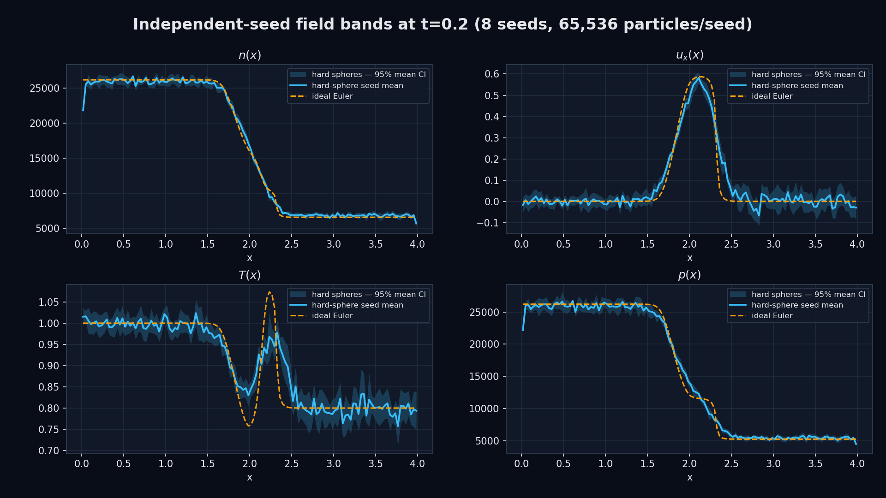

Field bands use two-sided Student-\(t\) intervals for the independent-seed
mean. Wave-marker locations are nonlinear and are not stable in every raw
65,536-particle realization, so their uncertainty is instead estimated from
the full seed-mean field and eight delete-one-seed jackknife replicates:

| marker | 8-seed mean-field \(c\) | jackknife 95% interval | ideal Euler \(c\) |
|---|---:|---:|---:|
| rarefaction gradient | -0.790 | [-0.997, -0.584] | -0.797 |
| contact | +0.696 | [+0.337, +1.055] | +0.698 |
| compression | +1.385 | [+0.762, +2.008] | +1.689 |

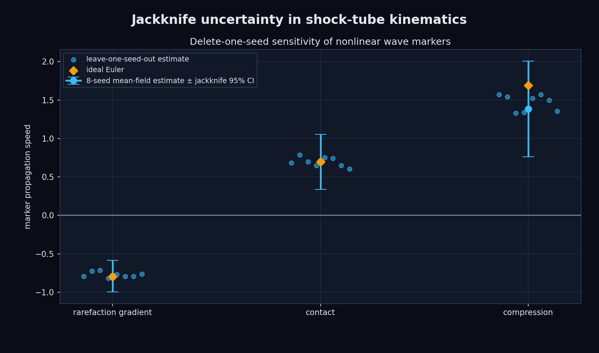

Euler lies inside all three approximate jackknife intervals. The rarefaction
and contact point estimates closely match Euler, so the +12.3% contact offset
in the first million-particle realization does not persist in this reduced-size
ensemble mean. This is not a like-for-like replication: particle count, slab
count, and scaled diameter differ. The compression marker also misses its
pre-registered fit-RMSE threshold by a small margin (0.03025 vs 0.03), and its
wide interval exposes insufficient marker resolution. The result therefore
supports the averaged field picture but motivates the particle-count and
Knudsen-number scans; it does not establish convergence to Euler.

The checked-in
[machine-readable summary](docs/results/multiseed-fields/summary.json),
[complete field bands](docs/results/multiseed-fields/field-bands.csv), and
[wave-speed table](docs/results/multiseed-fields/wave-speed-summary.csv)
record the statistics and hashes of all eight raw sources.

## Particle-count × Knudsen scan

This experiment varies statistical sample size and kinetic scale as
independent axes. A fixed-domain particle-count change would also change the
physical number density and therefore Kn. Instead, the scan holds the
longitudinal tube, local initial number density, temperature profile, and
target Kn fixed while scaling the periodic transverse area in proportion to
\(N\). Increasing \(N\) therefore adds transverse samples; it is not presented
as a fixed-volume Boltzmann–Grad limit.

The nominal initial Knudsen number is defined in the left state using
\(L_{\mathrm{macro}}=1\):

\[
Kn_\mathrm{left}=\frac{1}
{\sqrt{2}\,\pi n_\mathrm{left}d^2L_\mathrm{macro}}.
\]

[`configs/shock_tube_n_kn_scan.json`](configs/shock_tube_n_kn_scan.json)
freezes a \(3\times3\times4\) design: three particle counts, three Knudsen
levels, and four independent seeds per cell.

| \(N\) | transverse \(L_y=L_z\) |
|---:|---:|
| 131,072 | 0.353553 |
| 262,144 | 0.500000 |
| 524,288 | 0.707107 |

| target \(Kn_\mathrm{left}\) | diameter \(d\) | maximum initial packing fraction |
|---:|---:|---:|
| 0.02 | 0.00517991 | 3.05% |
| 0.05 | 0.00327607 | 0.77% |
| 0.10 | 0.00231653 | 0.27% |

Prepare or resume all 36 CUDA trajectories with:

```bash
python3 tools/run_n_kn_scan.py \
  configs/shock_tube_n_kn_scan.json \
  --executable build/cuda-release/particles_cli \
  --output output/n-kn-scan
```

The runner writes the complete derived matrix before launching work. Use
`--prepare-only`, `--cell`, `--max-cells`, or `--max-seeds` for inspection and
staged runs. Existing cells are reused only when their parsed configuration
is structurally identical.

After every cell has completed, analyze the field and wave trends with:

```bash
python3 tools/analyze_n_kn_scan.py \
  configs/shock_tube_n_kn_scan.json \
  output/n-kn-scan \
  --wave-config configs/wave_kinematics.json
```

The analysis writes per-cell conservation and final local-Kn quantiles,
particle/Euler field errors, Student-\(t\) uncertainty bands, log–log
finite-sample slopes, and jackknife wave speeds. Its main figures are
`field-error-scan.png`, `uncertainty-scaling.png`, and
`wave-speed-scan.png`. The two-count/two-Kn CPU smoke matrix validates the
pipeline only; its \(t=0.01\) fields are too early and too noisy for a
fluid-limit conclusion.

All 36 formal CUDA trajectories completed to \(t=0.20\), and every committed
state passed the configured energy and surface-gap checks. Across the 12
field/Kn combinations, the fitted 95% CI half-width slopes with particle
count range from -0.59 to -0.45, with mean -0.508. This is consistent with the
expected finite-sample \(N^{-1/2}\) signature. The corresponding mean-field
Euler-error slopes are much shallower, from -0.25 to -0.05, showing that
increasing the transverse sample size removes noise faster than it removes
systematic model differences.

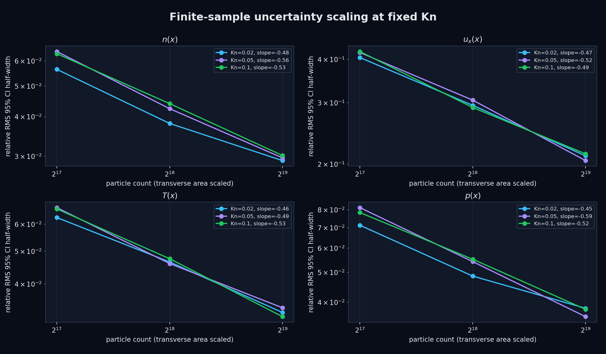

At the largest particle count, the final-field comparison is:

| target \(Kn_\mathrm{left}\) | density rel. \(L_2\) | velocity rel. \(L_2\) | temperature rel. \(L_2\) | pressure rel. \(L_2\) |
|---:|---:|---:|---:|---:|
| 0.02 | 3.37% | 17.70% | 3.11% | 4.27% |
| 0.05 | 2.00% | 19.46% | 3.47% | 3.53% |
| 0.10 | 2.15% | 21.66% | 3.88% | 4.05% |

Velocity and temperature move toward the Euler result as Kn decreases, but
density and pressure are best at the intermediate setting. The scan therefore
does not support a blanket monotone-convergence claim. Lowering Kn here is
implemented by increasing the sphere diameter at fixed number density, which
also raises the maximum initial packing fraction from 0.27% at Kn=0.10 to
3.05% at Kn=0.02. Finite-Kn transport, excluded-volume effects, coarse-graining,
and Euler-reference error are consequently not fully separated by this
matrix. Also, relative velocity error is amplified by slabs where the Euler
velocity is close to zero: those slabs add particle noise to the numerator of
the global \(L_2\) metric but almost nothing to its reference norm.

As the confidence bands tighten, the Euler-in-band slab fraction can decrease:
at Kn=0.02 it falls from 77.3% to 39.1% for density and from 78.1% to 50.0%
for pressure between the smallest and largest \(N\). This is not a failed
coverage test; it is evidence that increasing sample size is exposing a
spatially structured systematic difference that was previously hidden by
noise.

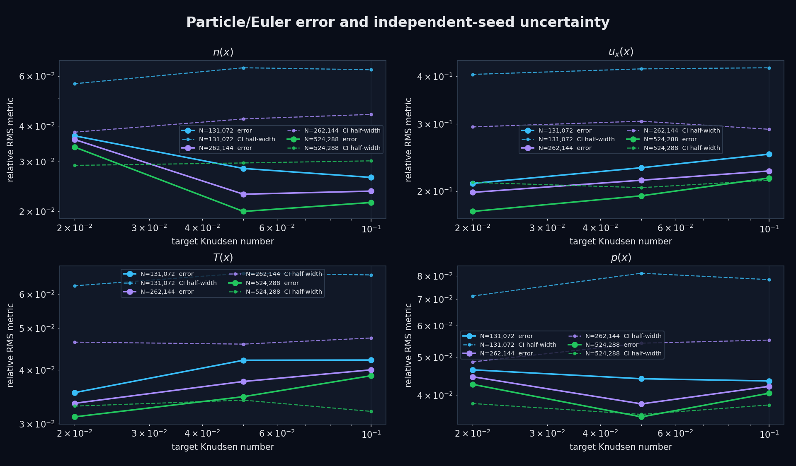

The final local Kn distribution is strongly inhomogeneous. For the
\(N=524{,}288\) cells, the 5%/median/95% quantiles are approximately
0.020/0.032/0.076, 0.050/0.081/0.200, and 0.099/0.160/0.407 for the three
nominal levels. The high quantiles are expected in the low-density right
state; a single input Kn must not be read as a global property of the evolved
shock tube.

All three pre-registered wave-marker checks pass at Kn=0.02 for every particle
count. At \(N=524{,}288\), their speeds are -0.790, +0.742, and +1.687 versus
ideal-Euler values -0.797, +0.698, and +1.689. Across the full matrix there are
no extraction failures, but six of 27 marker fits emit pre-registered warnings,
concentrated in the compression marker and the higher-Kn cells. Four seeds per
cell give broad jackknife intervals, so these wave results are diagnostics,
not precise asymptotic estimates.

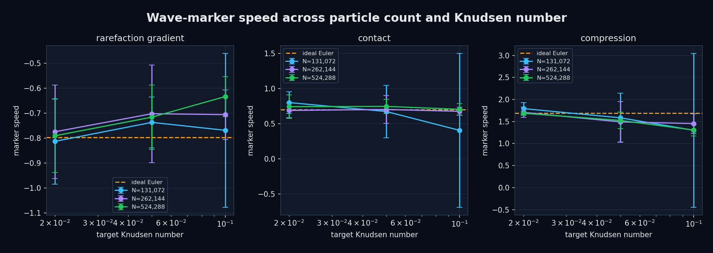

The checked-in [analysis summary](docs/results/n-kn-scan/summary.json),
[per-cell diagnostics](docs/results/n-kn-scan/cell-summary.csv),
[field table](docs/results/n-kn-scan/field-scan.csv),
[finite-sample trends](docs/results/n-kn-scan/trend-summary.csv), and
[wave table](docs/results/n-kn-scan/wave-scan.csv) record the complete results
and raw-source hashes. The raw trajectories remain external experiment
artifacts rather than Git-tracked source files.

## Enskog-Euler comparison and velocity-error diagnosis

Reuse the completed factorial scan to compare the particle fields with both
the ideal Euler reference and an inviscid hard-sphere reference:

```bash
python3 tools/analyze_enskog_comparison.py \
  configs/shock_tube_n_kn_scan.json \
  output/n-kn-scan
```

The second reference closes the conservation laws with the
Carnahan--Starling hard-sphere equation of state,

\[
\eta=\frac{\pi nd^3}{6},\qquad
Z(\eta)=\frac{1+\eta+\eta^2-\eta^3}{(1-\eta)^3},\qquad
p=nk_BT Z.
\]

This is the equilibrium, inviscid hydrodynamic limit associated with Enskog
theory; it is not a solver for the full Enskog kinetic equation and contains
no Enskog viscosity or heat conduction. The particle CSV stores the kinetic
pressure \(nk_BT\), not collisional momentum flux. Consequently, the matched
hard-sphere pressure comparison applies the same Carnahan--Starling closure
to every particle seed before averaging.

At \(N=524{,}288\), replacing ideal Euler by this Enskog-Euler reference does
not explain the velocity discrepancy:

| target Kn | ideal-Euler velocity rel. \(L_2\) | Enskog-Euler velocity rel. \(L_2\) | ideal-reference peak-normalized RMS difference | ideal-reference 95% CI relative RMS half-width |
|---:|---:|---:|---:|---:|
| 0.02 | 17.70% | 18.03% | 5.65% | 21.09% |
| 0.05 | 19.46% | 19.82% | 6.20% | 20.44% |
| 0.10 | 21.66% | 21.79% | 6.91% | 21.37% |

The apparently large percentage is primarily a metric-support effect. The
reference velocity is appreciably nonzero in only about 18% of the tube, so
its domain RMS is only about 31.9% of its peak. A physically modest 5.6--6.9%
peak-normalized RMS discrepancy therefore becomes a 17.7--21.7% domain
relative \(L_2\) value. Across the nine cells, 45.6% of the squared velocity
error lies in nominally quiet slabs, and the four-seed confidence half-width
is comparable to or larger than the measured mean-field discrepancy.

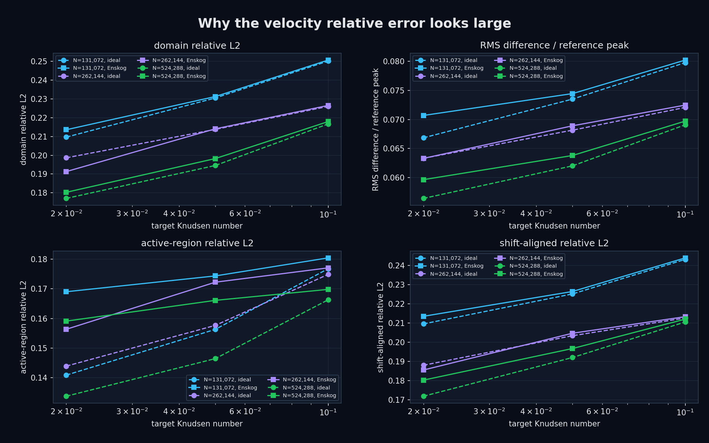

The velocity profiles remain strongly correlated with the references
(0.965--0.985). Optimally shifting a reference by at most one 0.015625-wide
slab reduces the median ideal relative error only from 21.37% to 20.96%, so
wave-position error is not the dominant cause. At Kn=0.02 the
Carnahan--Starling correction raises the initial left-state pressure by 13.2%
and predicts a slightly stronger velocity pulse; this marginally worsens the
velocity error while improving the largest-\(N\) density error from 3.37% to
3.23%. It does not yield a general four-field improvement.

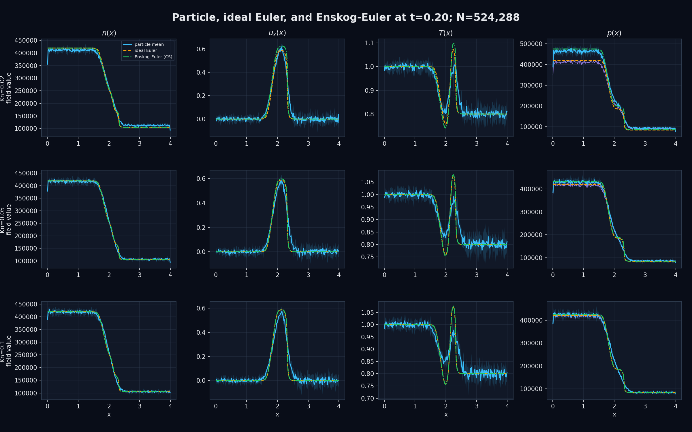

The 2048/4096-cell reference check changes the worst-case Enskog velocity by
only 0.259% in relative \(L_2\), far below the particle/reference difference.
The remaining mismatch is therefore more plausibly a combination of finite-Kn
dissipative broadening and finite-seed velocity noise than continuum-reference
grid error or the equilibrium hard-sphere equation of state alone. See the
[machine-readable summary](docs/results/enskog-comparison/summary.json),
[field comparison](docs/results/enskog-comparison/field-comparison.csv),
[velocity diagnostics](docs/results/enskog-comparison/velocity-diagnostics.csv),
and [reference grid check](docs/results/enskog-comparison/reference-grid-check.csv).

## Enskog Navier--Stokes--Fourier transport comparison

The next reference adds the first-Sonine Enskog shear viscosity, bulk
viscosity, and thermal conductivity to the same Carnahan--Starling pressure
closure:

```bash
python3 tools/analyze_enskog_nsf_comparison.py \
  configs/shock_tube_n_kn_scan.json \
  output/n-kn-scan \
  --nsf-cells 512
```

For number density \(n\), hard-sphere diameter \(d\), contact value
\(\chi=(1-\eta/2)/(1-\eta)^3\), and dilute hard-sphere coefficients
\(\mu_B,\kappa_B\), the implemented longitudinal stress and heat flux are

\[
\tau_{xx}=\left(\frac{4}{3}\mu+\zeta\right)\partial_x u,
\qquad q_x=-\kappa\partial_xT,
\]

\[
\begin{aligned}
\zeta & =\frac{4}{9}n^2d^4\chi\sqrt{\pi m k_BT},\\
\mu & =\frac{\mu_B}{\chi}
 \left(1+\frac{4\pi nd^3\chi}{15}\right)^2+\frac{3}{5}\zeta,\\
\kappa & =\frac{\kappa_B}{\chi}
 \left(1+\frac{2\pi nd^3\chi}{5}\right)^2
 +\frac{3k_B}{2m}\zeta.
\end{aligned}
\]

The finite-volume solver uses the Enskog-Euler MUSCL/Rusanov/SSP-RK2
hyperbolic update, centered conservative dissipative fluxes, adiabatic
reflecting walls, and the minimum of hyperbolic and explicit diffusion CFL
bounds. It is a first-gradient continuum closure, not a numerical solution of
the nonlocal Enskog kinetic equation.

At \(N=524{,}288\), the final-time relative \(L_2\) errors change as follows
(ideal Euler → Enskog NSF; parentheses show the relative change in error):

| target Kn | \(n\) | \(u_x\) | \(T\) | mechanical \(p\) |
|---:|---:|---:|---:|---:|
| 0.02 | 3.37% → 2.97% (-11.8%) | 17.70% → 9.42% (-46.8%) | 3.11% → 1.19% (-61.7%) | 4.27% → 3.24% (-24.0%) |
| 0.05 | 2.00% → 1.88% (-6.1%) | 19.46% → 11.86% (-39.1%) | 3.47% → 1.80% (-48.0%) | 3.53% → 2.48% (-29.9%) |
| 0.10 | 2.15% → 2.58% (+20.1%) | 21.66% → 21.76% (+0.5%) | 3.88% → 2.45% (-36.9%) | 4.05% → 3.48% (-14.2%) |

This isolates the main cause of the low-Kn velocity mismatch: equilibrium
excluded-volume pressure was not enough, while dissipative momentum and heat
transport reproduce much of the particle pulse broadening. The result is
consistent across all three particle counts. At Kn=0.10, however, the NSF
velocity no longer improves and the density error grows. That is useful
negative evidence that a first-order gradient expansion is leaving its
hydrodynamic regime; higher-order or kinetic Enskog physics is then the more
appropriate comparison.

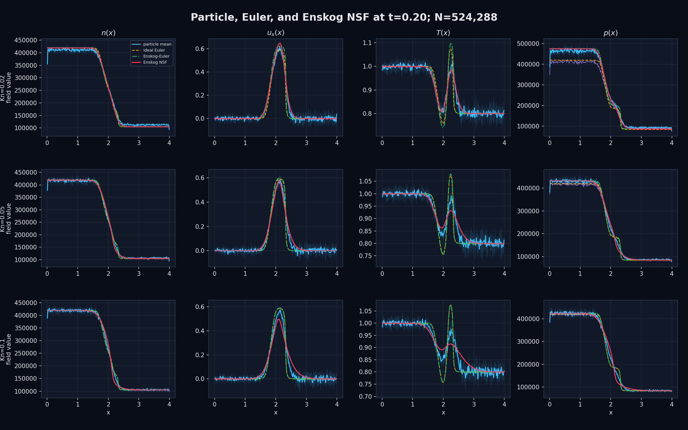

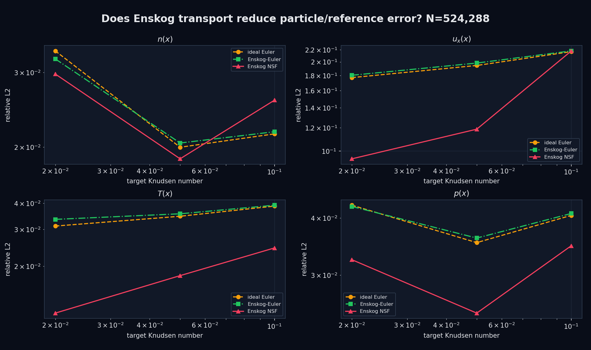

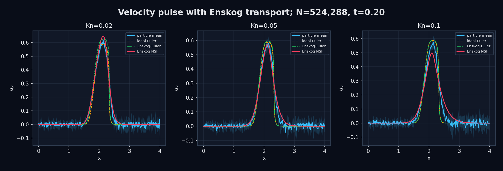

The 512/1024-cell check changes the worst-case low-Kn NSF velocity by only
0.0311%; all 512-cell formal runs remain positive without retrying a step,
and their relative mass/energy drift stays below \(7.4\times10^{-15}\). The
[summary](docs/results/enskog-nsf-comparison/summary.json),
[field comparison](docs/results/enskog-nsf-comparison/field-comparison.csv),
[velocity diagnostics](docs/results/enskog-nsf-comparison/velocity-diagnostics.csv),
[transport diagnostics](docs/results/enskog-nsf-comparison/transport-coefficients.csv),
and [grid check](docs/results/enskog-nsf-comparison/reference-grid-check.csv)
record the complete comparison and input/tool hashes.

This reference intentionally uses NumPy rather than adding PhiFlow as a
project dependency. The available PhiFlow environment is useful for generic
tensor operations and differentiable PDE experiments, but it does not remove
the need to implement the compressible conservative flux, Carnahan--Starling
thermodynamics, and state-dependent Enskog transport used here. Keeping this
small one-dimensional reference independent also makes the result easier to
reproduce in CI. PhiFlow remains a reasonable later option for inverse or
differentiable experiments.

### Transport ablation: what actually fixes the velocity profile?

The constitutive terms can be switched independently without changing the
Carnahan--Starling thermodynamics or the finite-volume grid:

```bash
python3 tools/analyze_enskog_transport_ablation.py \
  configs/shock_tube_n_kn_scan.json \
  output/n-kn-scan \
  --nsf-cells 512
```

The five variants are zero transport, shear viscosity only, shear plus bulk
viscosity, heat conduction only, and full NSF. At \(N=524{,}288\), their
velocity relative \(L_2\) errors are:

| target Kn | zero transport | shear only | shear + bulk | heat only | full NSF |
|---:|---:|---:|---:|---:|---:|
| 0.02 | 17.924% | **9.084%** | **9.073%** | 16.124% | 9.418% |
| 0.05 | 19.701% | **10.940%** | **10.941%** | 19.969% | 11.857% |
| 0.10 | 21.656% | **20.296%** | **20.297%** | 23.397% | 21.763% |

These zero-transport values differ slightly from the earlier 2048-cell
Enskog-Euler table because every ablation deliberately uses the same 512-cell
grid. The comparison identifies shear viscosity as the dominant source of the
low-Kn velocity improvement: it lowers the error by 36--49% across all three
particle counts at Kn=0.02 and by 30--44% at Kn=0.05. Adding bulk viscosity
changes the velocity error by at most 0.12% relative to the shear-only value.
The direct bulk-induced velocity-profile increment is 0.02969% on 512 cells
and 0.02972% on 1024 cells, so its small size is resolution-stable.

Heat conduction has a different role. Used alone, it reduces the temperature
error by 42--64% across the nine cells, but it worsens velocity at Kn=0.05 and
0.10. Once momentum transport is active, adding heat conduction also raises
the largest-\(N\) velocity error by 3.8%, 8.4%, and 7.2% at the three Kn
levels. Because the PDE response is nonlinear, these sequential changes are
diagnostics rather than additive physical percentages. The result supports a
more precise interpretation: shear viscosity explains most of the low-Kn
velocity broadening, heat conduction explains much of the temperature
smoothing, and the full first-order closure over-diffuses parts of the
higher-Kn solution.

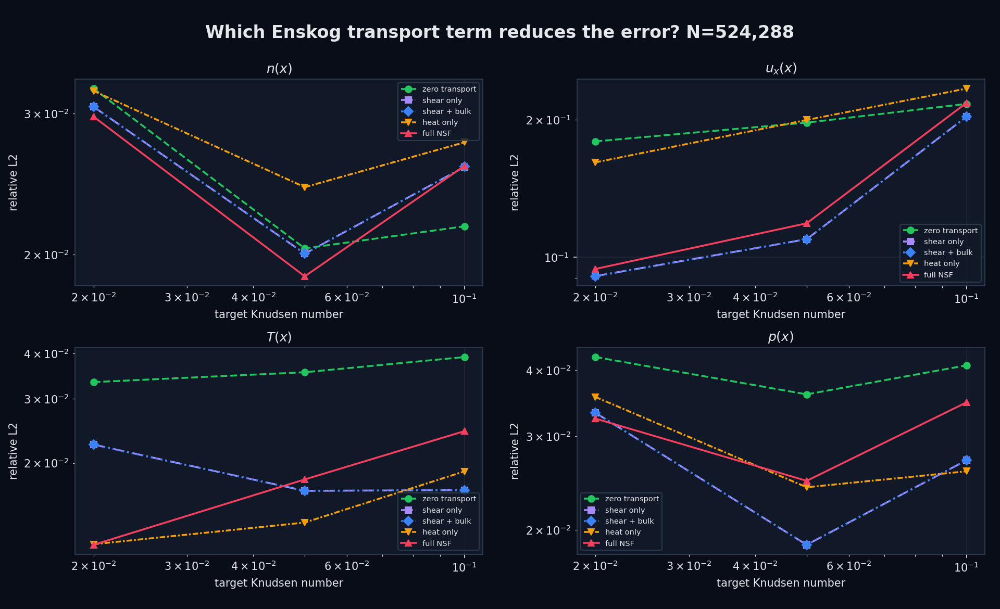

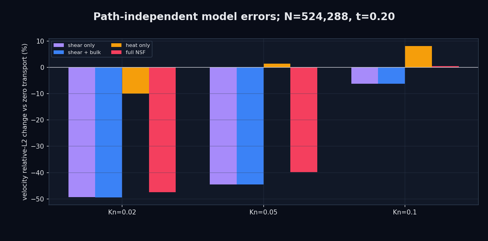

The [summary](docs/results/enskog-transport-ablation/summary.json),
[field table](docs/results/enskog-transport-ablation/field-ablation.csv),
[velocity table](docs/results/enskog-transport-ablation/velocity-ablation.csv),
[sequential attribution](docs/results/enskog-transport-ablation/velocity-attribution.csv),
[solver diagnostics](docs/results/enskog-transport-ablation/solver-diagnostics.csv),
and [bulk-increment grid check](docs/results/enskog-transport-ablation/bulk-increment-grid-check.csv)
record the reproducible result.

### Does the transport improvement persist in time?

The final frame alone can hide a transient failure. Reuse all ten saved
post-initial frames from each completed scan cell with:

```bash
python3 tools/analyze_enskog_transport_evolution.py \
  configs/shock_tube_n_kn_scan.json \
  output/n-kn-scan \
  --nsf-cells 512
```

At the largest particle count, the velocity-error change relative to the
same-grid zero-transport reference is:

| target Kn | shear: better frames | shear: mean / final change | full NSF: better frames | full NSF: mean / final change |
|---:|---:|---:|---:|---:|
| 0.02 | 8 / 10 | -23.6% / -49.3% | 8 / 10 | -22.2% / -47.5% |
| 0.05 | 4 / 10 | +1.6% / -44.5% | 4 / 10 | +8.0% / -39.8% |
| 0.10 | 1 / 10 | +44.8% / -6.3% | 0 / 10 | +56.5% / +0.5% |


The low-Kn benefit is therefore temporal, not merely a favorable final-frame
sample, but it is not instantaneous: at Kn=0.02 the shear curve first becomes
better at \(t=0.06\). At Kn=0.05 the reference is worse through the early and
middle transient and becomes better only over the final four frames. At
Kn=0.10, first-order transport is worse over essentially the whole interval.
This sharpens the earlier conclusion from “NSF helps at low Kn” to “NSF
captures late-time low-Kn broadening after an unresolved kinetic transient.”

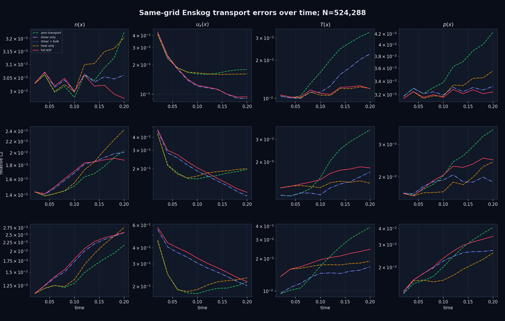

The positive velocity component containing the peak was also measured above
5% of its peak. At Kn=0.02, shear-only reduces the all-time relative RMSE of
peak amplitude from 8.77% to 2.99% and of RMS width from 9.82% to 6.71%.
At Kn=0.05 and 0.10, zero transport remains closer in these aggregate shape
metrics even though the Kn=0.05 terminal field error eventually improves.
This separates late-time profile agreement from full-history pulse accuracy.

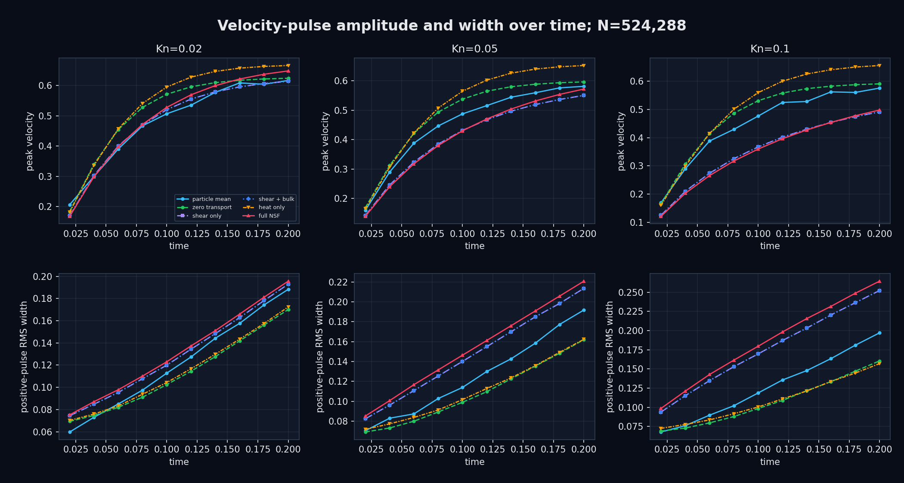

The ten frames are repeated observations of the same four seeds, not ten
independent replicates; they test temporal persistence but do not narrow the
four-seed sampling uncertainty. The pulse-width result also depends on the
declared 5%-of-peak support threshold. The archived
[summary](docs/results/enskog-transport-evolution/summary.json),
[temporal table](docs/results/enskog-transport-evolution/temporal-summary.csv),
[field evolution](docs/results/enskog-transport-evolution/field-evolution.csv),
[velocity evolution](docs/results/enskog-transport-evolution/velocity-evolution.csv),
[pulse evolution](docs/results/enskog-transport-evolution/velocity-shape-evolution.csv),
and [solver diagnostics](docs/results/enskog-transport-evolution/solver-diagnostics.csv)
record the complete result and source hashes. No new CUDA run is required.

CUDA is enabled automatically when `nvcc` is available. A CPU-only build can
be requested explicitly:

```bash
cmake -S . -B build-cpu \
  -DCMAKE_BUILD_TYPE=RelWithDebInfo \
  -DPARTICLES_ENABLE_CUDA=OFF
cmake --build build-cpu -j
ctest --test-dir build-cpu --output-on-failure
```

The default CUDA build targets compute capability 7.5 and retains PTX for
forward JIT compatibility. For performance measurements, configure for the
actual GPU, for example:

```bash
cmake -S . -B build-native \
  -DCMAKE_BUILD_TYPE=Release \
  -DCMAKE_CUDA_ARCHITECTURES=native
```

The matching preset is:

```bash
cmake --preset cuda-release
cmake --build --preset cuda-release
ctest --preset cuda-release
```

Install the CLI, example configurations, tools, license, and documentation:

```bash
cmake --install build --prefix /your/install/prefix
```

The million-particle shock tube is intentionally not a quick-start command. On
the first RTX 3050 Ti run it required roughly two hours; validate the
4096-particle smoke configuration before starting it.

## Project information

- License: [Apache-2.0](LICENSE)
- Citation: [`CITATION.cff`](CITATION.cff)
- Contributing: [`CONTRIBUTING.md`](CONTRIBUTING.md)
- Security reports: [`SECURITY.md`](SECURITY.md)
- Release history: [`CHANGELOG.md`](CHANGELOG.md)
- Release procedure: [`RELEASE_CHECKLIST.md`](RELEASE_CHECKLIST.md)

## Current milestone

The current scaffold provides:

- dimensionless shock-tube configuration;
- validated JSON loading for shock-tube and equilibrium experiments;
- reproducible non-overlapping spatial initialization;
- Maxwell velocity sampling with exact sampled-momentum correction;
- CPU continuous collision-time prediction for equal hard spheres;
- CPU elastic collision response;
- a small-scale, `O(N^2)` CPU event-driven reference simulator;
- reflecting walls and periodic boundary crossings;
- hard-sphere collisions through periodic images;
- shared CPU/CUDA uniform-grid indexing;
- CUDA structure-of-arrays particle storage;
- CUDA in-place ballistic free flight;
- CUDA cell-id generation and CUB radix sorting;
- dense cell start/end ranges with explicit empty-cell sentinels;
- two-pass CUDA neighbor-pair generation using CUB exclusive scan;
- periodic 27-cell traversal with duplicate-cell and duplicate-pair suppression;
- conservative candidate-validity horizon from cell width, speed, and walls;
- CPU/CUDA continuous collision-time evaluation over periodic images;
- compact valid-event arrays produced by a second CUB exclusive scan;
- CUB minimum reduction for the globally earliest collision time;
- deterministic earliest-time batches anchored by an absolute tolerance;
- per-particle participation counts that separate parallel-safe events from
  shared-particle collision chains;
- deterministic minimum-pair serialization for shared-particle chains;
- zero-time event rebuilds that propagate Newton-cradle-style impulses;
- CPU/CUDA advancement to the shared earliest-batch time;
- race-free equal-mass impulses for parallel-safe event indices;
- post-collision periodic wrapping and stale-event invalidation;
- batch momentum, kinetic-energy, state-match, and penetration diagnostics;
- per-particle reflecting-wall times with multi-axis corner masks;
- repeated CUDA cell/event rebuilds until a requested time window completes;
- explicit `collision_conflict`, `mixed_event_tie`, and `batch_limit` stops;
- a CPU prototype of the fixed-window mutual-earliest collision rule;
- a CUDA implementation using per-particle minimum-time and deterministic
  pair-key selection;
- mixed periodic/reflecting parallel windows in which wall events compete with
  particle collisions and boundary-aware free flight handles post-event
  motion;
- an exact short-window recovery path for zero-time collision chains that
  cannot be eliminated by further parallel-window bisection;
- race-free CUDA response for disjoint accepted events, including each
  event's post-collision remainder of the window;
- device-side endpoint gap and overlap reductions;
- a configured causal collision-chain experiment whose coarse window fails
  and refined windows recover the exact two-collision trajectory;
- a configured multi-seed, high-collision-rate stress scan with detailed and
  aggregated CPU/CUDA reports;
- transactional CPU/CUDA particle-state checkpoints with overlap-triggered
  rollback and local window bisection;
- an adaptive stress report that separates committed collision work from
  rejected attempts;
- a constant-density CUDA weak-scaling scan from \(2^{10}\) through
  \(2^{20}\) particles with throughput, memory, conservation, and penetration
  diagnostics;
- a shared-state micro/meso/macro snapshot pipeline with representative
  particles, \(x-v_x\), slab fields, and moment-reconstruction checks;
- a multi-frame shock-tube runner with CPU fallback, CUDA execution, adaptive
  rollback, and a per-interval evolution report;
- an offline synchronized micro/meso/macro renderer with fixed visual scales,
  publication PNG output, artifact metadata, and recorded-state MP4 framing;
- a conservative one-dimensional \(\gamma=5/3\) Euler numerical reference,
  grid-refinement check, synchronized overlays, and per-field error reports;
- independent rarefaction/contact/compression marker extraction, constrained
  propagation-speed fits, and a coarse-graining sensitivity report;
- resumable independent-seed CUDA batches, Student-\(t\) field confidence
  bands, and delete-one-seed jackknife wave-speed uncertainty;
- a density-preserving factorial \(N\times Kn\) runner with resumable cells,
  local-Kn reporting, field-error trends, and uncertainty-scaling plots;
- an inviscid Carnahan--Starling Enskog--Euler reference with matched
  hard-sphere pressure closure, grid refinement, and velocity-error
  decomposition;
- a conservative Enskog Navier--Stokes--Fourier reference with first-Sonine
  shear/bulk viscosity and heat conduction, three-model error plots, and a
  reference-grid check;
- a same-grid five-model Enskog transport ablation that separates shear,
  bulk, and thermal effects without rerunning particle trajectories;
- automatic \(\Delta t,\Delta t/2,\Delta t/4\) comparison with the exact
  event-driven reference;
- convergence CSV output with state error, collision-count, conflict,
  conservation, candidate-horizon, penetration, and runtime diagnostics;
- conservation and analytic collision tests;
- an optional CUDA target that verifies the local CUDA toolchain.

The CPU implementation intentionally recomputes all candidate events after
every event. It is a correctness oracle, not the path to million-particle
performance.

The CUDA correctness controller now repeatedly rebuilds events, resolves
parallel-safe collisions, deterministically serializes collision chains, and
handles reflecting walls until its requested time or an explicit stop
condition. It still performs a global earliest-event reduction per batch, so
it is not the final million-particle throughput path. The window-parallel rule
and fixed/adaptive reports now run on both CPU and CUDA. The mixed-boundary
million-particle shock tube has completed through \(t=0.2\), and its 11
synchronized states can now be rendered as the micro/meso/macro video above.
The one-dimensional \(\gamma=5/3\) Euler reference is evaluated at those same
output times as a diagnostic-only overlay. Particle/Euler wave locations and
propagation speeds now have a first passing comparison, and the reduced-size
eight-seed field bands are complete. The formal 36-trajectory
particle-count/Knudsen CUDA matrix and its archived cross-cell analysis are
also complete. The equilibrium Enskog-Euler comparison shows that the
hard-sphere equation of state alone does not remove the velocity discrepancy.
The Enskog Navier--Stokes--Fourier comparison then cuts the largest-\(N\)
velocity error by 46.8% at Kn=0.02 and 39.1% at Kn=0.05, but provides no
velocity improvement at Kn=0.10. This separates low-Kn dissipative broadening
from the higher-Kn regime where a first-order continuum closure is no longer
enough. The follow-up ablation attributes nearly all low-Kn velocity
improvement to shear viscosity, finds a resolution-stable but negligible bulk
contribution at the present packing fractions, and shows that heat conduction
primarily improves temperature while degrading velocity at higher Kn.
